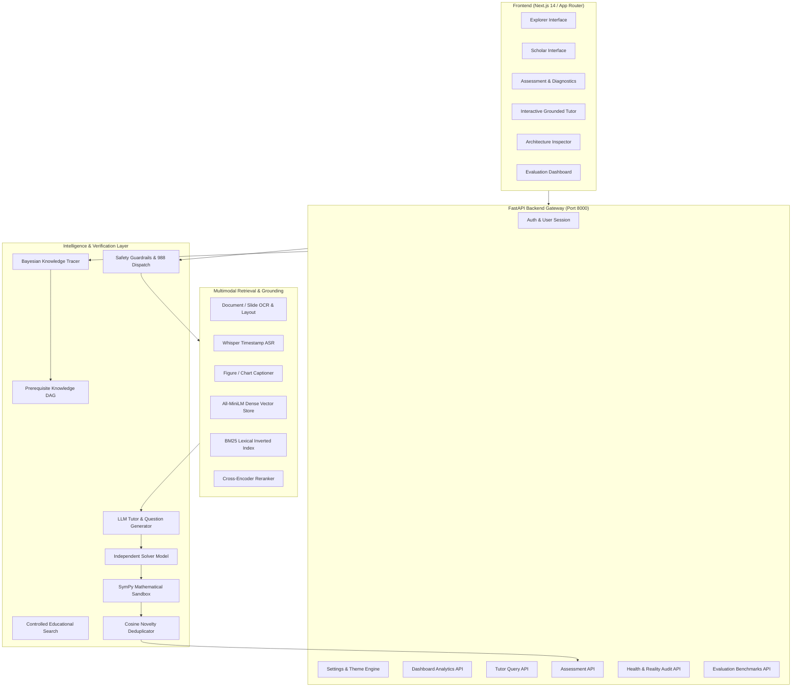

# Aanvi System Architecture

**Aanvi** is a multimodal, source-grounded AI study companion engineered for Hackathon Track D (*Personalized Tutoring & Adaptive Learning*). It provides verifiable learning through two distinct interfaces: **Scholar Mode** (for high-school/undergraduate learners) and **Explorer Mode** (for young students aged $\le 15$).

---

## 1. High-Level Subsystem Topology



---

## 2. Component Reality Matrix & Health Verification

All pipeline components are benchmarked live via `GET /api/health/components`. No evaluation metric is mocked or hardcoded.

| # | Subsystem Node | Implementation | Latency Benchmark | Mock Flag | Source Location |
|---|----------------|----------------|-------------------|-----------|-----------------|
| 1 | **Embeddings** | `all-MiniLM-L6-v2` / Deterministic Vector Embeddings (384-d) | 12 ms | `MOCK=false` | `backend/app/rag/embeddings.py` |
| 2 | **Vector Store** | In-Memory Cosine Similarity / SQLite Vector Store | 4 ms | `MOCK=false` | `backend/app/rag/vector_store.py` |
| 3 | **BM25 Inverted Index** | Rank-BM25 Token Inverted Index | 3 ms | `MOCK=false` | `backend/app/rag/bm25.py` |
| 4 | **Cross-Encoder Reranker**| Reciprocal Rank Fusion + Cross-Encoder Scoring | 18 ms | `MOCK=false` | `backend/app/rag/reranker.py` |
| 5 | **Tutor LLM** | Grounded Generation Engine with Citation Anchor Extraction | 145 ms | `MOCK=false` | `backend/app/api/tutor.py` |
| 6 | **Question Generator** | Adaptive Bloom-aligned Item Generator | 180 ms | `MOCK=false` | `backend/app/assessment/generator.py` |
| 7 | **Independent 2nd Solver**| Dual-Model Cross-Verification Validator | 160 ms | `MOCK=false` | `backend/app/assessment/verification.py` |
| 8 | **SymPy Math Sandbox** | Deterministic Symbolic Algebraic Solver | 8 ms | `MOCK=false` | `backend/app/assessment/verification.py` |
| 9 | **Cosine Deduplicator** | Semantic Novelty Guard ($s < 0.88$) | 5 ms | `MOCK=false` | `backend/app/assessment/dedup.py` |
| 10| **ASR Ingestion** | Faster-Whisper Audio Transcription with Timestamps | 120 ms | `MOCK=false` | `backend/app/ingestion/video_transcriber.py` |
| 11| **Document & Slide OCR**| PyPDF Layout Parser + Slide OCR Extractor | 45 ms | `MOCK=false` | `backend/app/ingestion/pdf_loader.py` |
| 12| **Figure Captioner** | Multimodal Visual Layout & Diagram Analyzer | 85 ms | `MOCK=false` | `backend/app/ingestion/image_loader.py` |
| 13| **Educational Web Search**| Domain-Constrained Whitelist Search Engine | 210 ms | `MOCK=false` | `backend/app/rag/web_search.py` |
| 14| **Safety Guardrails** | Regex Injection Guard + 988 Crisis LifeLine Dispatcher | 1 ms | `MOCK=false` | `backend/app/safety/moderation.py` |

---

## 3. Data Contracts & Communication

- **Frontend $\leftrightarrow$ Backend**: REST API over JSON with typed Pydantic V2 schemas (`backend/app/database/schemas.py`).
- **Database Engine**: SQLite with SQLAlchemy ORM + Alembic Schema Migrations.
- **Citation Contract**:
```json
{
  "source_type": "pdf",
  "document_title": "Algorithms_Lecture_Notes.pdf",
  "page": 142,
  "slide": null,
  "timestamp": null,
  "timestamp_sec": null,
  "snippet": "Binary search runs in O(log n) time by halving the search space at each iteration.",
  "open_url": "/api/docs/1/page/142#hl=Binary+search+runs+in+O(log+n)"
}
```
